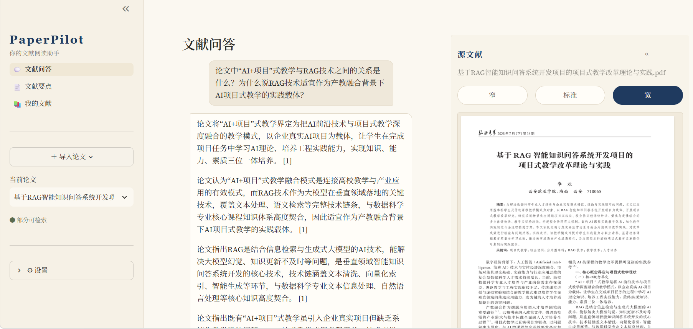
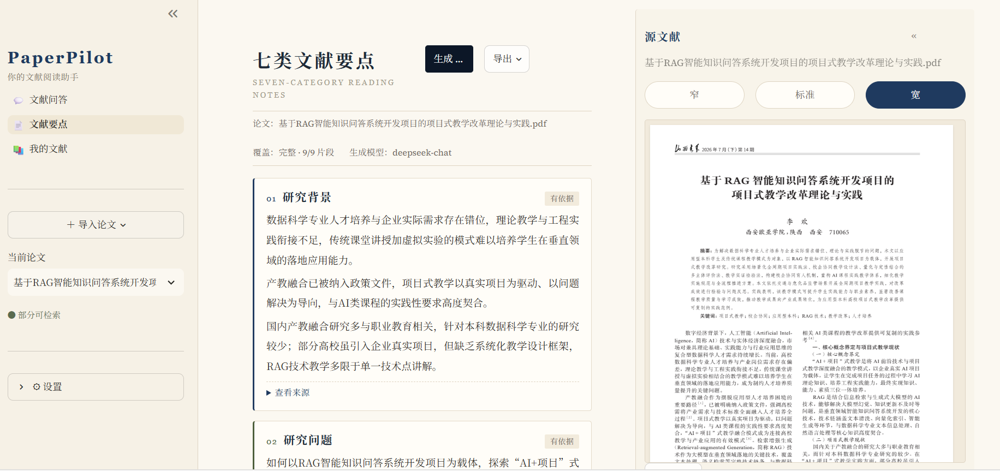
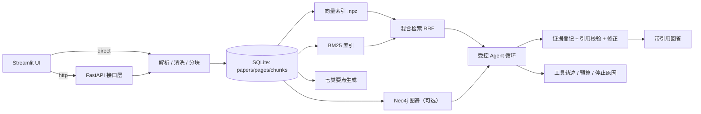

# PaperPilot

**带证据的文献阅读 Agent**：上传 PDF 并建立索引 → 按需生成固定七类阅读要点 → 在文献内提问并给出可核对的引用 → 可选用 Neo4j 构建知识图谱。

> 个人项目，面向求职展示。所有数据保存在本机，不依赖云端数据库；Neo4j 是可选组件，关闭后其余功能完整可用。

---

## 界面预览

| 文献问答 | 七类文献要点 |
|---|---|
|  |  |

- 左侧为原生多页导航（文献问答 / 文献要点 / 我的文献）；
- 右侧「源文献」抽屉默认收起，展开后可整篇 PDF 连续滚动、缩放、按页阅读；
- 问答回答下方提供可展开的「引用与依据」，每个数字引用都能定位到片段与页码。

---

## 为什么做这个

直接让大模型“读论文并回答”，最危险的不是答错，而是**编造引用**：看起来有出处，实际原文里没有。

PaperPilot 的核心约束是：

1. **结论必须有证据**：引用只能来自本次运行中程序回读并登记的片段（`evidence_id`），不能凭空生成；
2. **没有就说没有**：缺失的要点标注“论文未报告 / 证据不足”，不为了填满字段而编造；
3. **固定七类结构**：研究背景、研究问题、研究方法、实验设计、主要结论、创新与贡献、局限性。

---

## 功能特性

| 功能 | 说明 |
|---|---|
| 文献入库 | PDF 解析、页眉页脚清洗、句子边界分块、哈希去重、原子写入 |
| 七类阅读要点 | 固定 7 个字段，状态分 `supported / not_found / insufficient_evidence`，带覆盖率 |
| 文献内问答 | 受控 Agent 工具循环（检索、回读、要点、图谱），预算与重复调用保护 |
| 证据与引用 | 片段锚点 `chunk_id` + 运行内证据 `evidence_id`，引用强校验，支持一轮自动修正 |
| 混合检索 | 向量检索（bge-m3）+ 关键词 BM25（jieba），RRF 融合 |
| 知识图谱（可选） | Neo4j 存 Paper/Chunk/Entity/Claim，4 类关系，3 个查询模板，证据对齐后入图 |

---

## 快速开始

### 1. 环境

- Windows / macOS / Linux，Python **3.11**
- 可选：Neo4j Desktop（仅图谱功能需要）

```powershell
python -m venv .venv
.\.venv\Scripts\Activate.ps1
python -m pip install -U pip
pip install -e ".[dev]"
```

### 2. 配置

复制模板并填写密钥（`.env` 已在 `.gitignore` 中，不会提交）：

```powershell
Copy-Item .env.example .env
```

最少需要：

| 变量 | 用途 |
|---|---|
| `CHAT_API_KEY` | 对话模型（默认 OpenAI 兼容 DeepSeek） |
| `EMBEDDING_API_KEY` | 向量模型（默认硅基流动 `BAAI/bge-m3`，也可复用 `SILICONFLOW_API_KEY`） |
| `PAPERPILOT_DATA_DIR` | 数据目录（建议放在仓库外） |
| `GRAPH_MODE` | `off` / `auto` / `on`；默认 `off` |
| `NEO4J_PASSWORD` | 仅 `auto/on` 时需要 |

### 3. 启动

```powershell
streamlit run app.py
```

浏览器打开后：左侧「＋ 导入论文」上传 PDF → **文献问答**（默认首页）→ **文献要点** → **我的文献**；切换论文时右侧内容同步切换。

### 4. 测试

```powershell
python -m unittest discover -s tests
```

修复后新增离线边界测试（最终测试数量见 `docs/fixes_2026-11-06.md`）（配置、存储、解析、清洗、分块、检索、证据、Agent、要点、图谱、评测、API）。

### 5. 一条命令演示

```powershell
python scripts/demo.py --question "这篇论文的研究方法是什么？"
python scripts/demo.py --with-graph
```

脚本依次完成：入库（可选 `--pdf`）→ 建立索引 → 生成/复用七类要点 → Agent 问答（打印引用与工具序列）→（可选）构建并查询知识图谱。

### 6. HTTP API（可选）

后端可以独立运行，Streamlit 之外也能调用（当前 Streamlit 仍为直连模式，API 为并行能力）：

```powershell
uvicorn api.main:app --reload --port 8000
```

打开 `http://127.0.0.1:8000/docs` 可直接试接口：

| 方法 | 路径 | 作用 |
|---|---|---|
| GET | `/health` | 健康检查（含图谱模式） |
| GET | `/papers` | 文献列表 |
| POST | `/papers` | 上传 PDF 入库 |
| DELETE | `/papers/{id}` | 删除文献 |
| GET | `/papers/{id}/pdf` | 下载原文 PDF |
| GET / POST | `/papers/{id}/summary` | 读取 / 生成七类要点 |
| POST | `/papers/{id}/chat` | 提问并返回引用与工具轨迹 |

**切换到 HTTP 模式**（可选，默认 `direct`）：

```ini
PAPERPILOT_API_MODE=http
PAPERPILOT_API_URL=http://127.0.0.1:8000
```

此时 Streamlit 的文献列表、上传/删除/重新处理、PDF 下载与预览、问答、要点、图谱片段来源均通过 API 完成。

**向量后端**（可选，默认 `numpy`）：

```ini
VECTOR_BACKEND=numpy   # 默认，本地 .npz
VECTOR_BACKEND=chroma  # 需 pip install -e ".[chroma]"
```

切换只影响向量路，BM25 与 RRF 融合不变；Chroma 元数据带 `paper_id / revision`，按论文与修订过滤。

---

## 架构



### 代码结构

```
paperpilot/
├── config.py              # 环境变量、目录、能力开关
├── schemas.py             # Paper/Page/Chunk/Summary/GraphMode 等数据模型
├── storage.py             # SQLite（schema v2，另有 agent_runs 任务日志，含图谱状态）
├── llm.py                 # 对话与 embedding 提供方（含 hash 测试实现）
├── ingestion/
│   ├── parser.py          # pypdf 解析
│   ├── cleaning.py        # 页眉页脚清洗
│   ├── chunker.py         # 句子边界分块（v2）
│   └── pipeline.py        # 入库编排
├── rag/
│   ├── indexing.py        # 向量索引（numpy .npz）
│   ├── keyword.py         # BM25（jieba 分词，自实现）
│   └── retrieval.py       # 混合检索 + RRF
├── evidence/              # evidence_id 登记、回读、范围校验
├── tools/                 # search_chunks / read_passages / get_key_points / query_graph
├── agent/                 # 预算、工具循环、引用修正
├── summary/               # 七类要点生成与校验
└── graph/                 # Neo4j 客户端、关系抽取、构建

tests/                     # 单元测试与故障回归测试
docs/                      # 设计、查询示例与界面截图
scripts/                   # 演示脚本
api/                       # FastAPI 接口层（独立运行）
app.py                     # Streamlit 入口
```

---

## 核心设计

### 证据模型

- `chunk_id`：论文范围内的片段锚点（含页码、偏移、内容指纹）；
- `evidence_id`：**运行内**证据编号，只有 `read_passages` 回读成功才会登记；
- 最终答案的每个 `[ev_xxx]` 必须指向本次运行登记的证据，否则触发修正或失败。

### 七类要点

固定 7 个 key，模型只负责填内容，程序做结构校验：

- `supported`：有证据支持；
- `not_found`：覆盖率完整且确实未提及；
- `insufficient_evidence`：有相关内容但不足以支撑。

覆盖率同时记录计划/已处理/总数，避免“只看了一半就说没有”。

### 受控 Agent

- 预算：默认 8 步、12 次工具调用、120 秒；
- 工具白名单：检索、回读、要点、图谱；
- 重复调用检测、空回答检测、引用校验；
- 停止原因可解释：`BUDGET_STEPS / BUDGET_TOOL_CALLS / TIMEOUT / REPEATED_CALL / INVALID_CITATION / EMPTY_ANSWER`；
- 最终输出使用 `status + claims` JSON；每条回答声明必须提供本次运行证据，拒答/澄清由程序输出固定文字。
- 结构或引用无效时最多修正一轮；失败正文不会发布。取消或超过截止时间后不发布结果。
- 运行状态、工具轨迹和结果保存到 SQLite 的 `agent_runs` 表，可用 `python scripts/runs.py` 查看。
- `GRAPH_MODE=off` 不向模型注册图谱工具；`on` 要求当前修订的图谱就绪，否则明确报错。

### 混合检索

- 向量路：bge-m3，1024 维，归一化后点积 = 余弦；
- 关键词路：jieba 分词 + BM25（`k1=1.2, b=0.75`），IDF 按检索范围统计；
- RRF 融合（`k=60`），按 `chunk_id` 去重，稳定排序；
- 索引按“论文 + 修订”隔离，旧修订不会泄漏。

### 知识图谱（可选）

- 节点：`Paper / Chunk / Entity / Claim`；
- 关系：`SUBJECT / OBJECT / SUPPORTED_BY / IN_PAPER / HAS_CHUNK`；
- 4 类声明：`USES_METHOD / APPLIED_IN / PRODUCES / SUPPORTS_CONCLUSION`；
- 抽取时要求 `evidence_text` 必须能在片段中（忽略空白）找到，对不上则 `pending_review`，不参与查询；
- 三个查询模板：方法→实验、实验→结果、结论支撑；
- 作为 Agent 工具按需调用：是否查询图谱由 Agent 根据问题自行判断，关系型问题通常更有帮助；
- 生成七类要点时也可把图谱关系作为辅助线索，但引用与结论仍必须以原文片段证据为准；
- `GRAPH_MODE=off` 时完全不连 Neo4j，其余功能正常。

---

## 评测结果（修复版，2026-11-07）

数据集：22 题人工确认集（paper_002 10 题 + paper_001 12 题，含 3 道无答案题），
`evaluation/datasets/eval_all.jsonl`，top_k=5。

| 配置 | 完成率 | Recall@5 | 引用覆盖 | 无答案拒答 | 标准证据命中 | 平均耗时 |
|---|---|---|---|---|---|---|
| A 纯检索 | - | 0.789 | - | - | - | - |
| B 检索 + 图谱 | - | 0.789 | - | - | - | - |
| C Agent | 1.000 | - | 0.864 | 1.000 | 0.789 | 11.5s |
| D Agent + 图谱 | 1.000 | - | 0.864 | 1.000 | 0.789 | 8.8s |

- 图谱候选没有提升检索 Recall@5（A = B = 0.789）；
- D 组有 9 道题实际调用了图谱工具，但标准证据命中与 C 持平（0.789），**未观察到图谱带来指标提升**；
- 3 道无答案题在 C/D 中均正确拒答（1.000）；
- 小样本单次运行，结论仅作参考，不宣称普遍有效或无效；
- 评测代码、数据集与原始报告在 `evaluation/`，复现命令：

```powershell
python -m evaluation.run --dataset evaluation/datasets/eval_all.jsonl --config A --top-k 5
python -m evaluation.run --dataset evaluation/datasets/eval_all.jsonl --config B --top-k 5
python -m evaluation.run --dataset evaluation/datasets/eval_all.jsonl --config C
python -m evaluation.run --dataset evaluation/datasets/eval_all.jsonl --config D
```

---

## 设计取舍

| 决策 | 原因 |
|---|---|
| 用 numpy `.npz` 而不是 Chroma | 当前语料几千片段，全量点积毫秒级；少一个重依赖，索引可读可重建；接口已隔离，未来可换 Chroma/FAISS |
| SQLite 管事实、JSONL 存档 | 单机零部署、事务与去重方便；片段原文是权威来源，索引均为派生物 |
| Neo4j 可选 | 图谱是增强项，不是运行前提；不可用时自动降级为普通检索 |
| jieba + 自实现 BM25，而非 FTS5 | 不引入 FTS5 虚拟表与 MATCH 语法转义，逻辑可单测；规模变大后可平替 |
| 句子边界分块（v2） | 长段落按句末标点切分再合并，避免硬切造成引用含无关内容 |
| 引用修正只做一轮 | 给模型一次改正机会，同时防止无限重试与成本失控 |
| 单一模型基线 | 先把“证据—校验”闭环做扎实，多模型路由后置 |

---

## 已知限制

- 当前仅承诺本机单用户部署；UI 与 API 请按一种入口进行数据修改，同步网络请求不能保证立即物理中断。
- 图谱构建的跨存储原子切换、图谱写入中断后的恢复仍需后续完善。
- 图谱对综述类论文抽取结果很稀疏（缺少方法—实验链条），这是数据特性，不是 bug；
- 实体归一化较简单，可能出现同一概念多个 `Entity` 节点；
- 关键词路是轻量 BM25，同义词/缩写召回仍依赖向量路；
- UI 功能完整但仍有细节打磨空间（响应式、暗色模式等）。

